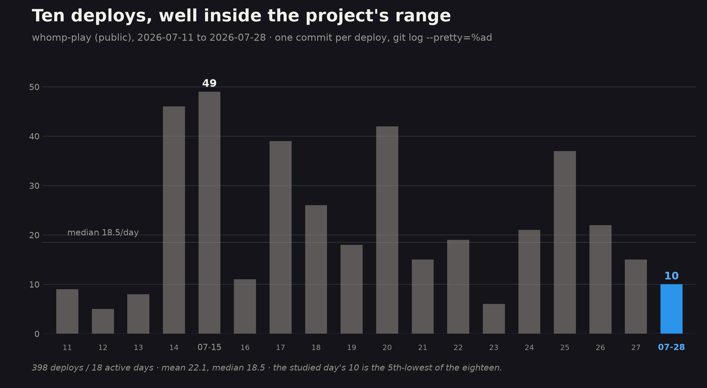

# My decision queue was frozen for 41.9 hours. The board went from 24% to 95%.

A model told me that decision latency, not build speed, bottlenecks human-AI collaboration. I went looking in the git ledgers of my own studio. The latency is real and enormous. It is also, on the evidence, close to free, and the reason why is the part worth keeping.

Kevin Madson · 2026 · <a href="https://github.com/KiwiMaddog2020/decision-latency">Code</a> · <a href="mailto:kevinmadson@protonmail.com">Email</a>

On 2026-07-28, reading my notes on agentic operating loops, the conductor model made a claim:

> "The bottleneck in human-AI collaboration is never build speed, it's decision latency."

It sounds right, which is why it needs checking. I run a setup where coding agents build a
game in parallel lanes and I ratify the decisions. If the claim holds anywhere it should hold
in my own logs. So I went to the instruments that do not depend on anyone's memory: the commit
history of the game's source repo, the commit history of the public deploy repo, and the
planning documents the sessions wrote as they went.

The claim is half right, and the wrong half is the useful one. The latency is real and large.
The oldest item I can date sat open 116.6 hours; the median item still pending at the end of
the window sat 43.3 hours. It cost close to nothing, because the system had been shaped,
partly on purpose, so that a pending decision froze almost no work. What sets the pace is not
how long a decision waits. It is how much of the work graph waits with it.

## The setup

WHOMP is a browser game built almost entirely by coding agents. A conductor session plans and
merges, worker lanes build in parallel worktrees, and I play the build, file numbered reports,
and answer decision prompts. Every ship goes out through a gated script to a public GitHub
Pages repo, so each deploy leaves a public commit carrying a timestamp and the short sha of
the source commit it was built from. 397 of the 398 commits there read `play build <sha>` and
the first one reads `WHOMP v0.9.0 play build`, which makes the deploy repo a clean external
clock.

Three sources, all times PDT: the public deploy log; the private source log, whose citations
are verifiable by me alone and flagged where it matters; and the planning documents inside the
source repo, read at the commits that introduced them. What I did not have is the session
transcript, which holds the decision prompts and the moment I answered each one. It lives on my
machine, out of reach of the environment this was mined in. That gap biases everything below in
one direction: a decision answered in ten seconds and never written down leaves no trace, so
every latency here is measured only on decisions slow enough, or formal enough, to reach a
document.

## What the ledgers say, including about me

The deploy repo has ten builds on 2026-07-28: 02:18, 03:49, 05:53, 07:17, 09:32, 10:48, 12:50,
15:35, 16:47, 19:38. Span 17.3 hours, median gap 122.6 minutes, longest 170.7. The source repo
has 272 commits that calendar day, first at 00:37, last at 19:34, then silence. Forty-six of
those are merge commits, 21 of them carrying the `merge:` subject prefix the studio uses when
a lane lands. The shas cross-check against the day's checkpoint doc, which records deploy 26 as
"verified by sha 12:50pm"; the public repo has `play build a3cda2d` at 12:50.

First correction, and it is a correction of me. The handoff notes I wrote for this research
described that day from memory as roughly fourteen hours and five deploys. The ledger says ten
deploys across 17.3 hours. My recall of my own headline number was off by a factor of two, one
day later. Every count here now comes from a log, and anything I could not get from a log is
labelled missing rather than remembered.

The second correction is worse for the story I wanted to tell.

Ten deploys is not a busy day for this project. Across 18 active days it shipped 398 times, a
mean of 22.1 per day and a median of 18.5, with a record of 49 on 07-15. The day I picked
because it felt relentless is the fifth-lowest of the eighteen. A reader with the public repo
can falsify the flattering version in one command, so it belongs in the note, and it sharpens
the argument rather than blunting it: build capacity here demonstrably reaches 4.9 times the
studied day's output, so build speed was not the binding constraint that day either. The ten
builds carried whole-subsystem merges (the hub finale, a 33-card weapon overhaul completing, a
second glow-up wave) where 07-15's forty-nine were fast iteration. Deploy count measures ships,
not throughput, and neither number is what the conductor's claim is about.

## Two queues, and the medium decides which one you are in

The decisions I can date fall into two populations that barely touch.

The fast queue first. Eighty-two commits across the project's history record a human ruling in
their subject line. Grouped into bursts, with consecutive rulings inside 30 minutes counted as
one sitting, they form 8 rapid-fire sessions and 34 gaps between consecutive rulings: median
6.4 minutes, min 1.4, max 26.3. The sharpest single case is committed at both ends. An audit
of 33 weapon-animation cards lands at 13:32:17 on 07-27, and the document recording a verdict
for every one of the 33 lands at 14:47:57. That is 75.7 minutes for 33 decisions, an upper
bound of 2.3 minutes per card, and an upper bound only, because the same window contains the
agent writing the ratification. The format was a two-column table, card and verdict. Twenty-three
of the 33 came back exactly as recommended (69.7%), the other 10 carrying an override in
bold; on a looser rule that counts any modifier at all, the unmodified rate is 57.6%. I report
both, because which rule to use is a judgement, not a measurement.

The studied day's own checkpoint, written at 14:41, carries a section headed "Today's ratified
decisions (all logged in TaskList #24-#31)". My first draft read that as eight decisions, which
is a third thing I got wrong: it is a task-id span, not a count. The section runs to five
bullets, two of them with no task id at all, and one bullet holds three separate rulings by
itself (manual aim as the mouse-and-keyboard default, "forgiving hitboxes... Overwatch not
CS:GO" preserved verbatim, soft-lock as the pad default). At least ten distinct rulings, all
made in session, all cleared the same day.

Between the extremes sit six items where one commit presents something for a ruling and a
later commit records the verdict: a void district map at 1.0 h, a planet-light elevation call
at 0.7 h, the 33 cards at 1.3 h, ability concepts at 6.6 h (and 5.3 minutes from the second
draft to ratification), a boss overhaul spec at 7.6 h, the statues at 13.5 h. Median 3.9 hours.

The slow queue is the other end. Thirteen items were sitting on pending lists at the end of the
window with no verdict text anywhere in the history: median age 43.3 hours, min 17.8, max
116.6, the oldest being an item written as "Maps standalone bigger (Kevin-gated)" first listed
on 07-23 at 22:56. Between the median gap inside a live ruling session and the median age of
an item still waiting, the spread is about 406-fold.

The split is not importance. The Borealisk pick, a boss redesign flagged "pending direction
pick" on 07-25 at 14:57 and still open 76.7 hours later at the day's last deploy, is the item
the checkpoint itself labels "BIGGEST content gate". It is both the most important open call
and among the oldest. What separates the queues is the medium the answer requires. A decision I
can make from the chair, reading a card, clears in minutes. A decision that needs me to launch
the game, walk somewhere, and form a taste verdict waits for days and gets batched into a lap.

The lap is measurable from outside. The 16:47:37 deploy put the rebuilt hub live. I toured it
and filed numbered reports. The fix lane ran 17:49:41 to 18:57:49, so 72.5 minutes of work, and
merged at 19:02:12 under the subject "hub live-fixes - all 21 director reports". That 21 is
exact: the lane's commits cite 18 report ids by number and three more as a seam class, ids 116
to 134 and 137 to 138. The next deploy, at 19:38:21, put all of them live. From the deploy that
exposed the flaws to the deploy that fixed them, 170.7 minutes for 21 verdicts and their fixes.

## The queue stopped moving and the board did not

Here is the artifact that revises the conductor's claim. On 07-27 at 01:40:00 a planning doc
gained a section headed "KEVIN VERDICT BASKET (tomorrow, batched - nothing blocks on these)",
eleven items, with a shorter six-item "Kevin verdict queue" beneath it as a strict subset. That
section is byte-identical in every later revision of the file and at the last commit of the
window, 41.9 hours on. One line below it, the same file's own "Board complete" counter moves
from ~24% to ~95%. The human decision queue was frozen and the board it sat beside moved 71
points.

That is the strong reading, and it needs a caveat carried right next to it. At least one basket
item was decided while the basket kept listing it: the ability-concept ratification is recorded
at 07-27 08:25:31 and the item was still on the list 19.4 hours later. Across the whole corpus,
no item was ever observed to leave a pending list because it had been answered. Every
disappearance I can trace is a document rewrite or a document going stale. So the byte-identity
proves the queue was never curated; it does not by itself prove nothing was answered. The
basket is a stale artifact as much as it is a maintained queue. Both readings are true, and the
second one is the more interesting: a queue nobody bothers to reconcile is a queue nothing is
waiting on.

The independent check is cleaner than either. A separate lane, with no idea this question
existed, audited every player report filed between 07-17 and 07-28 and dispositioned all 111 of
them: 105 fixed, 3 unaddressed, 1 superseded, 1 not-a-bug, and 1 needing a decision from me.
One report in 111, 0.9%, was blocked on a human. It is report 36, the same re-snap that had
been sitting on pending lists since 07-26 at 16:32:29, making it 46.1 hours old at the day's
checkpoint and 51.1 at the last deploy. Two more items were flagged in that same breath, a PvP
cousin test and a desert-snow-patches call, and both were still open 51.0 hours later. The
three unaddressed reports, flagged at 01:01:51, were fixed and merged by 02:20:08, 78.3 minutes
later, with no human in the loop at all. That 0.9% is a property of the instrument as much as
the person: an audit written to surface work routed 17 of about 75 findings to me, near 23%.
Audits generate decisions, bug reports generate work.

None of this was luck, and it reads as design in documents written before the question was ever
put to me. The basket's own heading says "nothing blocks on these". A backlog entry ends "So
this waits for Kevin." The multiplayer plan files my open calls under "OPEN DECISIONS FOR KEVIN
(rapid-fire menu)". The vocabulary treats a pending decision as a thing to route around, not a
thing to wait on.

So the falsifiable version of the claim is this: throughput is governed by the sum, over
pending decisions, of latency times the fraction of the work graph that decision freezes. Call
it blocked-lane-hours. Here the latencies were large and the frozen fractions were engineered
near zero, so the product stayed small and build speed set the pace.

I wanted a queueing-theory check to sit under that, and it does not survive contact with the
data. Rulings arrived at 23 on 07-25, 22 on 07-26, 12 on 07-27, and exactly 1 on 07-28. With
an arrival rate swinging more than twentyfold between adjacent days, Little's Law yields no
defensible expected wait, so it stays as a frame and not as arithmetic: a queue drained in
bursts will show long average ages even when nothing is stuck behind it.

## One reversal, with dates on it

I had listed reversal rate as unmeasured. There is one case, and it is worth more than the
silence. Report 54 asked to remove a boulder ring and set the mystery statues into an inner
semicircle. They were built at 07-26 20:22, revised at 22:13, revised again at 07-27 01:37
under a "Kevin live correction", and deleted at 09:50 by report 84: "mystery statues DELETED
(Kevin ruling)". Three build iterations over 13.5 hours, then the feature was removed by the
person who asked for it, and the reconciliation audit independently classes report 54 as
superseded. One case is not a rate. What it shows is that fast decisions here bought a rebuild
rather than a disaster, because the thing being decided was cheap to build and cheap to throw
away. That is the same design property as the blocking shape, seen from the other side.

## Prior art, and what is new here

None of the ingredients are new. Little's Law is from 1961. Code-review research at large
companies has measured for a decade that review turnaround, not coding time, dominates change
lead time, and that small, well-framed requests get faster answers. The interruption-cost
literature in CSCW has measured for longer that resuming deep work after a context switch costs
tens of minutes. Ousterhout's framing of engineering leadership as decisions per unit time
points the same way.

What I have not seen measured is the agentic case. When building, testing, reviewing and
merging are all machine-side, the human decision queue is the last human-shaped thing in the
loop, and the cheap levers on it (presentation format, batching policy, and buffers that let
work pivot around a pending answer) are design choices nobody is instrumenting. There is a
machine-side echo of the same shape in my oneshot-bench notes: "tuned harnesses spend 5-9% of
build cost on checking; unoptimized agent panels spend 50-70%." The deciding loop, human or
machine, is where the overhead lives.

## What was not measured

- **Arrival and answer times per decision.** They are in the transcript I could not read. The
  fast-queue gaps include the agent's own writing time between rulings, so they are upper
  bounds, and any decision that never reached a document is invisible, which biases every
  latency here long and every count low.
- **Removal-from-queue times.** They do not exist in this corpus. Arrivals date cleanly, and
  verdicts date cleanly when a verdict commit exists. The moment an item stopped being pending
  does not.
- **Presentation format effects.** The 33-card session establishes the format used and a
  2.3-minute-per-card ceiling. It does not establish that the format caused the speed. No
  prose control was run.
- **Answer quality.** Fast is not right. One dated reversal is not a reversal rate, and nothing
  here credits batching with better verdicts.
- **Lane concurrency.** Lane names were not written into merge subjects on 07-28, so agent
  parallelism cannot be counted directly. Reconstructing branch intervals from merge topology
  gives at most 6 side branches open at once, at 09:02, and 34.0 lane-hours across the day.
  That is a topology-derived lower bound on parallelism, not a count of running agents.
- **Confounds on the aged items.** The Borealisk clock includes nights, meals, and a life. Age
  in queue is not attention demanded, and a lane idle for three days may have cost nothing if I
  would not have staffed it anyway.
- **N.** One operator, a handful of days, observational, mined by the collaborator side of the
  collaboration. Read every number as a case study, not a distribution.

## What I would run next

Three experiments, preregistered before the next marathon so I cannot pick the flattering
reading afterwards. The format A/B: one class of decision presented as prose in some sessions and as a card with a
recommended default in others, measuring time-to-answer and later reversals, with the 69.7%
defaults-accepted rate as the number to beat or break. The replay: reconstruct a day's work
graph and run it under instant decisions, under the measured latencies, and with a work-stealing
buffer, reporting the throughput delta. And the cheapest, which should come first: stamp each
pending item at the moment it stops being pending, which turns most of the caveats above into
measurements.

## Takeaway

The aphorism compresses to "the human is the bottleneck". The ledgers say something more
precise: the human is the scarce resource, and whether scarcity turns into a bottleneck is a
design choice about blocking shape. Three cheap things did the work here. Keep the set of
decisions that can freeze work deliberately small, one report in 111. Batch verdicts by the
medium they need instead of answering them as they arrive, one lap, 21 rulings, 170.7 minutes.
Let everything else route around whatever is still pending, 41.9 hours frozen against 71 points
of board. A faster model would not have shipped an eleventh deploy that day. Whether one more
hour of my attention would have is exactly the measurement the next session should make.

---

*Method. Every number above was mined read-only from git: the public deploy repo, the private
source repo, and the planning documents at the commits that introduced them. Times are PDT
(`TZ=America/Los_Angeles`, committer offset -0700), one decimal on anything derived, and where
a figure is an upper or lower bound I have said which. A second pass re-verified the first draft
line by line against the repos and found four outright errors in it, including a report-36
anchor two hours and forty minutes late. Rebuilding the figures from raw values then caught
three more: two medians that had been rounded before averaging rather than after, and a claim
of "zero exceptions" with exactly one exception in it. The corrected values are the ones printed
here, and the wrong ones are listed in DATA.md rather than quietly dropped.*

*Verify it. The deploy ledger is public and every claim resting on it reproduces in one command
against [whomp-play](https://github.com/KiwiMaddog2020/whomp-play). Every other number, with
the exact command that produced it, is in [DATA.md](https://github.com/KiwiMaddog2020/decision-latency/blob/main/DATA.md)
in this repo. The game's source repo is private, so the rows citing it are owner-verifiable
only. I would rather label that plainly than dress private evidence up as public.*
